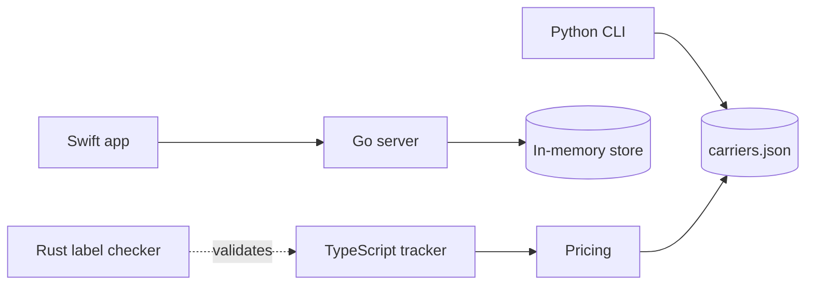
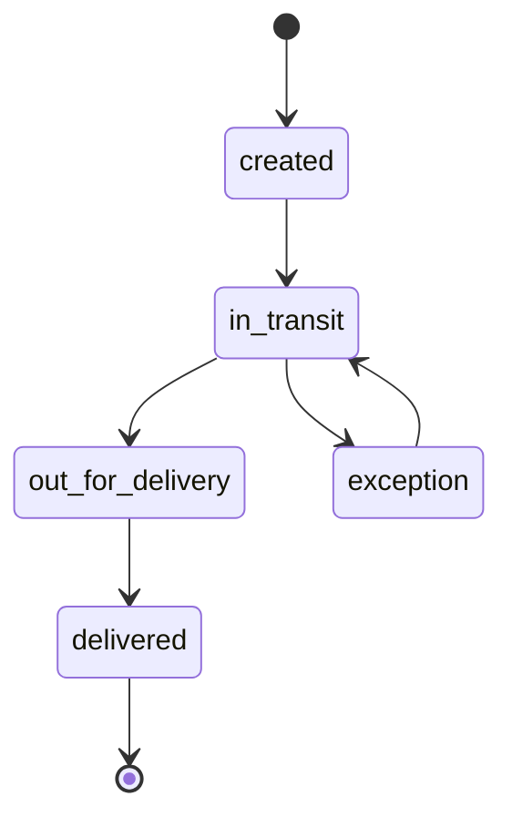

# Parcel playground

A small shipment tracking toolkit written in five languages. It exists to give
[Hermes](https://github.com/bojanrajkovic/hermes) realistic pull requests, CI runs, and issues
to render.

> [!NOTE]
> Nothing here ships. Break it freely.

> [!WARNING]
> The `tests` job fails on purpose when `.ci/fail-tests` exists on the branch.

## Layout

| Path | Language | What it does |
| --- | --- | --- |
| `src/ts` | TypeScript | Shipment state machine, pricing, formatting |
| `go` | Go | Read-only HTTP API over an in-memory store |
| `swift` | Swift | Models and an actor-based store |
| `python` | Python | Rate tables and the `parcel` CLI |
| `rust` | Rust | Tracking number checksum |
| `config` | JSON, YAML | Carrier rates and server defaults |

## Quick start

```sh
npm install
npm test
```

```ts
import { Tracker } from "./src/ts/tracker";

const tracker = new Tracker();
tracker.register(shipment);
tracker.record(shipment.id, "in_transit", "Boston, MA");
```

```go
st := store.New()
st.Put(store.Shipment{ID: "shp_1001", Carrier: "northwind", Status: "in_transit"})
```

```python
from parcel import cheapest, load_rates

rate = cheapest(load_rates(), weight_kg=2.3)
```

## How the parts fit





## Carriers

| Carrier | Base | Per kg | Max weight |
| :--- | ---: | ---: | ---: |
| Northwind Freight | $4.50 | $1.20 | 30 kg |
| Bluejay Express | $6.90 | $0.95 | 20 kg |
| Tortoise Ground | $2.99 | $1.40 | 50 kg |

## Roadmap

- [x] Shipment state machine
- [x] Flat pricing
- [ ] Zone-based pricing
- [x] Carrier registry
- [ ] Webhooks for delivery events

> [!TIP]
> See [docs/architecture.md](docs/architecture.md) for the request flow.

<details>
<summary>Why five languages?</summary>

So syntax highlighting and go-to-definition have something to chew on.

</details>
