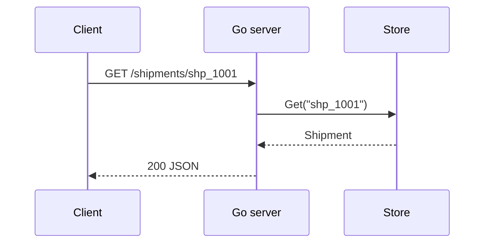
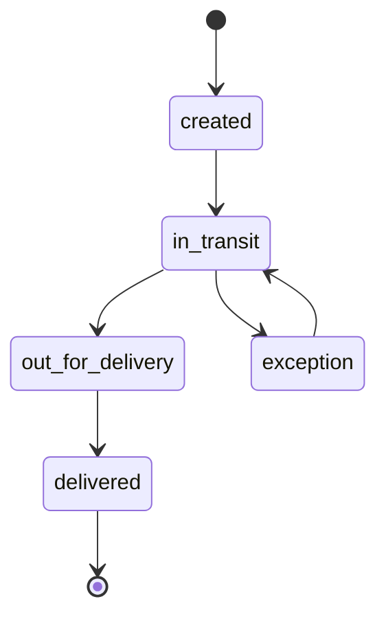

# Architecture

Parcel is split by language so each part stays small. The TypeScript library owns the
shipment state machine. The Go server exposes it over HTTP. Python and Rust are tools.

## Components

| Component | Language | Path | Responsibility |
| --- | --- | --- | --- |
| Tracker | TypeScript | `src/ts` | Shipment state machine and pricing |
| Server | Go | `go/cmd/server` | Read-only HTTP API |
| Rates CLI | Python | `python/parcel` | Cheapest-carrier lookup |
| Label checker | Rust | `rust` | Tracking number validation |
| App model | Swift | `swift` | Models for the macOS client |

## Request flow

## Shipment states

## Pricing

A quote is the base rate plus a per-kilogram charge on the billable weight. Billable weight
is the larger of actual weight and volumetric weight (litres divided by 5).

| Input | Value |
| --- | --- |
| Base rate | $4.50 |
| Per kg | $1.20 |
| Volumetric divisor | 5 |
