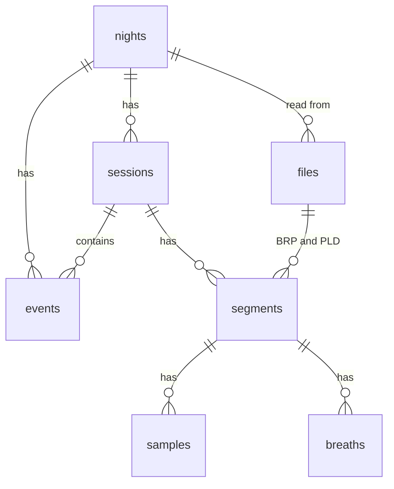

# Data model

The datasets, the derived tables, their units, and derived_version.

## Datasets

A dataset is something to query: a derived table of the same name, with each column described once. `DATASETS` in `@airway/contract/registry/datasets` lists the five.

| Dataset | One row per | Columns |
|---|---|---|
| `nights` | Night | The machine's `STR.edf` statistics, then airway's: session counts, the longest stretch, event counts, the AHI check, the rule set, and the upload time |
| `sessions` | Mask-on period | Start, end, duration, and whether it comes from the machine's mask-on times or from the recording files |
| `events` | Event the machine flagged | Type, source, duration, and whether it fell outside every mask-on period |
| `samples` | 2 seconds of therapy | The nine low-rate signals: pressures, leak, respiratory rate, tidal volume, minute ventilation, snore, and flow limitation |
| `breaths` | Breath airway detects in the flow signal | Duration, amplitude, and inspiratory volume |

`nights` keeps the machine's numbers apart from airway's. The machine's are the headline: `ahi` is the AHI the machine scored, and airway's event counts sit beside it under their own names.

Values are spelled out, such as `obstructive_apnea`, never the machine's codes.

`events`, `samples`, and `breaths` share three columns. `session` is the mask-on period's number within the night, so any of them can be broken down by session without a join. `night` is the sleep day. `hour_of_night` is the wall-clock hour in the home time zone.

A breath's amplitude and inspiratory volume are computed from the flow signal, so their units follow from flow's and are recorded with it in `column_units`: amplitude in flow's unit, and volume in litres when flow is in L/s.

`registry/columns.ts` holds the columns and units more than one dataset uses, and each dataset is one file beside it. The `nights` and `samples` tables get their machine-signal columns from these files, so a signal is listed once.

## Columns

A dataset is a list of columns, and each column is described once, in `@airway/contract/registry`. Everything that queries a dataset reads that one description.

`registry/define.ts` has one function per kind of column:

| Function | Role | For |
|---|---|---|
| `signal(name, description)` | metric | A value the machine recorded. Its unit comes from the file header ([Units](#units)) |
| `metric(name, unit, description)` | metric | A value airway computes, in a unit airway chooses |
| `dimension(name, kind, description)` | dimension | An integer or boolean to filter and group by |
| `enumeration(name, values, description)` | dimension | One of a fixed list of spelled-out values |
| `time(name, kind, description)` | time | A timestamp or a night |

Time and dimension columns can be grouped by, and metrics can't. `operationsFor(column)` gives the filter operations a column allows, which follow from its kind, so no column lists its own.

## Column SQL

A column's SQL is a `TrustedSql`: SQL that came from source code and never from a request, so it's safe to put in a statement. Only a computed column has one. It writes its SQL in a `sql` template, which accepts only another `TrustedSql` or the `homeZone` marker between its text, so interpolating any other value fails to compile.

A plain column has no SQL: it's the table column of its own name, and whoever builds a statement quotes that name.

```ts
const hour = sql`extract(hour from ts at time zone ${homeZone})::int`;
const hourOfNight = dimension("hour_of_night", "integer", "Wall-clock hour in the home time zone.", hour);

render(hour, { homeZone: 3 });
// extract(hour from ts at time zone $3)::int
```

`homeZone` stands for the `AIRWAY_TIME_ZONE` setting. `render` replaces it with the number of a bound parameter, so the registry names no zone and the zone never becomes SQL text.

## Units

A stored value keeps the machine's unit. The app shows some units as others: L/s as L/min, and L as mL.

A machine signal's unit and decimals aren't in the registry. Each EDF file's header declares a signal's unit and its physical and digital ranges, which give the step between two values. `decimalsForStep(step)` turns the step into the decimals needed to write every value. For example, an AirSense 10 declares leak in L/s with a step of 0.02, so leak has 2 decimals. Another model or firmware can declare a different unit or step, and nothing in the code assumes these. A column airway computes declares its unit and decimals in the registry.

`toDisplay(value, stored)` and `toStored(value, stored)` convert between the stored and display units. A stored value converts to display and back exactly.

For example, with leak stored in L/s and tidal volume in L, as an AirSense 10 declares them:

| Stored | Shown |
|---|---|
| 0.4 L/s | 24 L/min |
| 1.14 L/s | 68.4 L/min |
| 0.3 L | 300 mL |

`toStored` is how a value typed in display units becomes one to compare with stored values: a leak of 24 L/min is a stored 0.4.

## Derived tables

Everything airway derives from the card's files lives in one Postgres schema, `derived`. `derivedDdl(schema)` in `@airway/contract/derived/ddl` returns the statements that create it, and no other code creates a derived table. It takes the schema's name, so the same tables can be built in `derived_next` beside the ones in use.

Every table is UNLOGGED. The data can be rebuilt from the files, so it skips the write-ahead log and backups. A crash empties them.



| Table | One row per | Key |
|---|---|---|
| `nights` | Night with a folder on the card: the machine's `STR.edf` statistics, then airway's own columns | `night` |
| `sessions` | Mask-on period | `night, session` |
| `segments` | BRP file with data, and the PLD file that overlaps it | `night, segment` |
| `events` | Machine event. `session` is null when the night has no sessions, and `duration` when the machine gives none | none |
| `samples` | 2 seconds of therapy: the nine PLD signals | none |
| `breaths` | Breath detected in the flow signal | none |
| `files` | Imported file, with its size, SHA-256, and ctime. `night` is null for `STR.edf` and `Identification.tgt` | `path` |
| `device` | Machine: serial and model | `serial` |
| `settings_changes` | Setting that changed on a night | `night, setting` |
| `daily_usage` | Day `STR.edf` covers, used or not | `day` |
| `period_percentiles` | Week or month, and signal (leak or mask pressure): the P50 and P95 of its samples | `period, period_start, signal` |
| `column_units` | Machine signal: the unit and decimals its headers declare ([Units](#units)) | `dataset, column_name` |
| `meta` | The schema: its `derived_version` and when it was built | one row |

### Keys

Deleting a `nights` row deletes that night's rows from `files`, `sessions`, `segments`, `events`, `samples`, and `breaths`, through `ON DELETE CASCADE` foreign keys. One delete removes a night, and its rows go back in parents first. A `files` row that a segment was read from can't be deleted while the segment stays.

A sample or breath references its segment together with the segment's session, so its `session` can't disagree with the segment's.

`settings_changes`, `daily_usage`, `period_percentiles`, and `column_units` reference no night, because they cover days and periods that have no `nights` row.

### Values

Signal values are `double precision`. A value written as the decimal text `0.4` is stored as exactly 0.4, and `leak = 0.4` matches it. A `real` column wouldn't match: Postgres widens it to compare, and its 0.4 becomes 0.4000000059604645.

Text columns with a fixed set of values, such as an event's `type`, have a CHECK constraint, built from the lists in `derived/values.ts`. The registry's enum columns read the same lists.

### Indexes

- `(night, ts)` on `samples`, `breaths`, and `events`.
- `(ts)` on `samples`, because a "latest samples" query would otherwise scan the table.
- `(night, leak)` and `(night, mask_pressure)` on `samples`. They hand `percentile_cont` a night's values already sorted.
